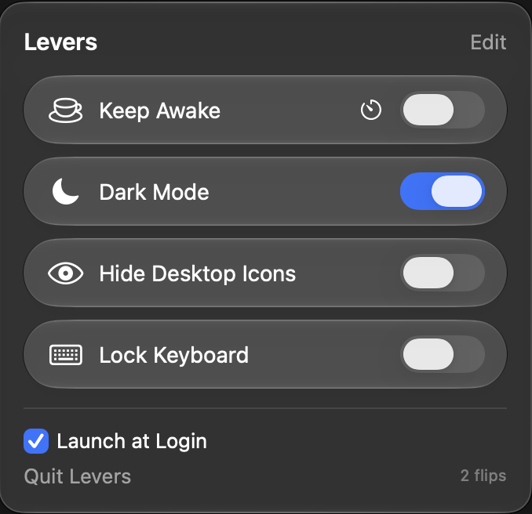
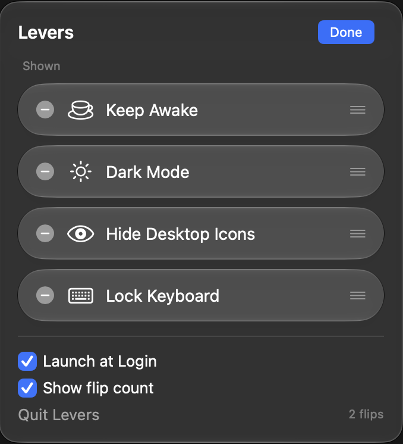

# Levers

**A tiny Mac menubar panel of switches for the things you toggle all day.**

 

- ☕ **Keep Awake**: keeps your screen on and your Mac awake, until you turn it off or for a set time (15 minutes to 8 hours, using the timer button).
- 🌙 **Dark Mode**: flips light and dark without opening System Settings.
- 👁️ **Hide Desktop Icons**: a clean desktop for screenshots, demos and screen sharing.
- ⌨️ **Lock Keyboard**: ignores every key so you can wipe the keyboard. The mouse still works, so you can always click it off.

Click **Edit** to hide switches you don't use or drag them into your own order. Tick **Launch at Login** to have it always there. The small number at the bottom right counts your flips; right-click it to hide it.

Free and open source (MIT). Needs **macOS 26** or later.

## Install

There's no ready-made download yet, so you build it yourself. It takes about a minute, and you need only Apple's free Command Line Tools, not Xcode.

1. Install the tools once, if you haven't: `xcode-select --install`
2. Build Levers, install it to your Applications folder and open it:

```bash
git clone https://github.com/jptramos/levers.git
cd levers
./scripts/install.sh
```

To update later, `git pull` and run `./scripts/install.sh` again. Your layout and settings are kept.

Levers appears in the menubar as three little sliders. It has no Dock icon.

## Permissions

Dark Mode and Lock Keyboard each ask once, the first time you use them. If you say no, the panel shows an **Open Settings…** link. After an update, `install.sh` tells you if keyboard access needs allowing again.

## Ideas and bugs

Want a new lever, or something's not working? [Open an issue](https://github.com/jptramos/levers/issues) or message [@jpramos on X](https://x.com/jpramos).

Building your own lever? See [docs/DEVELOPING.md](docs/DEVELOPING.md).

## License

MIT. See [LICENSE](LICENSE).
